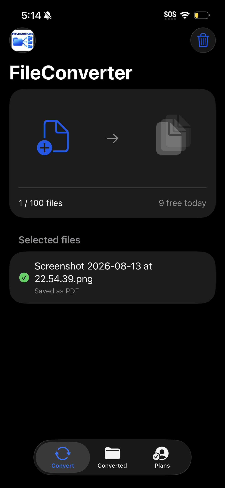
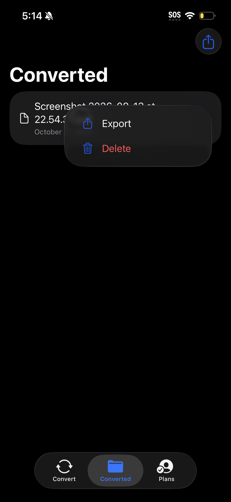

# FileConverterUltra

### Native file conversion for iPhone and iPad

An Ave Studios application built with Swift and SwiftUI. Import a batch, choose a compatible output format, and export converted files without uploading their contents to a conversion server.

**Release status:** Version 1.0, build 1 was submitted to Apple App Review on October 27, 2026. Approval and public availability are pending.

## App Preview

  
  

## Product Highlights

- Import up to 100 files in one batch using the system file picker.
- Run conversions sequentially with progress and individual file results.
- Stop after the current file without interrupting that conversion.
- Preview converted documents, share outputs, and manage local copies.
- Use 10 successful conversions per day on the free plan; unsupported and failed conversions do not consume the allowance.
- Unlock unlimited conversions through monthly or yearly Apple subscriptions, with purchase restoration and no separate app account.
- Keep file processing on-device. This version includes no advertising or analytics SDK.

## Supported Workflows

| Source | Output |
| --- | --- |
| Supported images | PNG, JPEG, HEIC, TIFF, PDF |
| PDF | First-page image export or extractable text |
| UTF-8 text | PDF |
| Compatible audio and video | AAC audio in M4A |
| Compatible video | MP4 or MOV |

Compatibility depends on Apple-supported decoders and codecs. PDF text extraction does not perform OCR. Image output is capped at 4096 pixels on the longest edge; inputs are limited to 250 MB, with a 2 MB limit for text-to-PDF conversion. Unlimited subscriptions remove the daily quota, not batch, format, or device-storage limits.

## Engineering Overview

| Area | Implementation |
| --- | --- |
| Interface | SwiftUI, native iPhone and iPad navigation |
| Conversion | Native Apple image, PDF, and audiovisual frameworks |
| Processing | Sequential batch execution and per-file failure handling |
| Persistence | Local output records and successful daily conversion counts |
| Monetization | StoreKit 2 products, verified entitlements, transaction updates, and restore |
| File access | System document import, local previews, and sharing |

The conversion pipeline separates format eligibility, processing, and result reporting. Unsupported files are skipped rather than producing placeholder outputs. The free-use counter persists across ordinary restarts and is local to an installation, not a server-enforced cross-device quota.

## Validation and Delivery

- 22 simulator smoke checks covering conversion, batch import, quota handling, failures, and persistence.
- Manual simulator testing of format selection, text-to-PDF conversion, navigation, and preview.
- Physical-device TestFlight testing, with both subscription plans reported working in Apple's sandbox.
- App Store submission includes iPhone/iPad screenshots and the two subscription products.

This is a portfolio showcase, not the application source repository. It contains no app binaries, signing materials, customer data, or private configuration. Screenshots show the actual application.

## Project Summary

Native iOS/iPadOS utility combining on-device batch file conversion, a SwiftUI interface, persistent local output management, and StoreKit 2 subscriptions, delivered through TestFlight and submitted for App Store review.

**Ave Studios** · [GitHub portfolio](https://github.com/sheneria) · [Contact](mailto:avestudiosofficial@gmail.com)

Copyright 2026 Ave Studios. All rights reserved. Public visibility of this showcase does not grant a license to the application or its branding.
